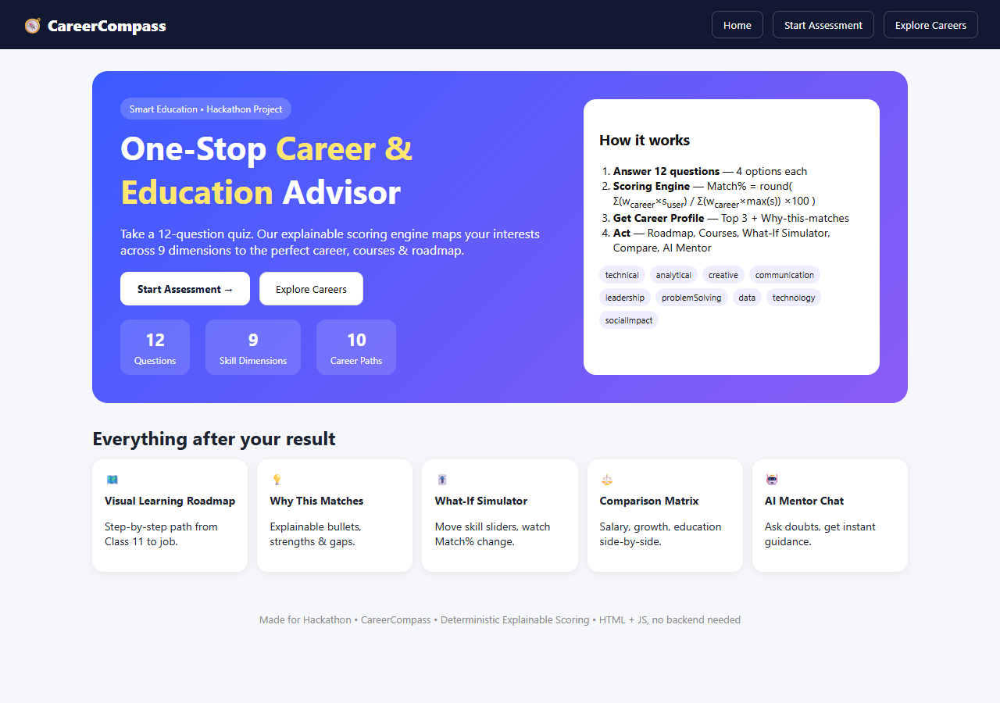
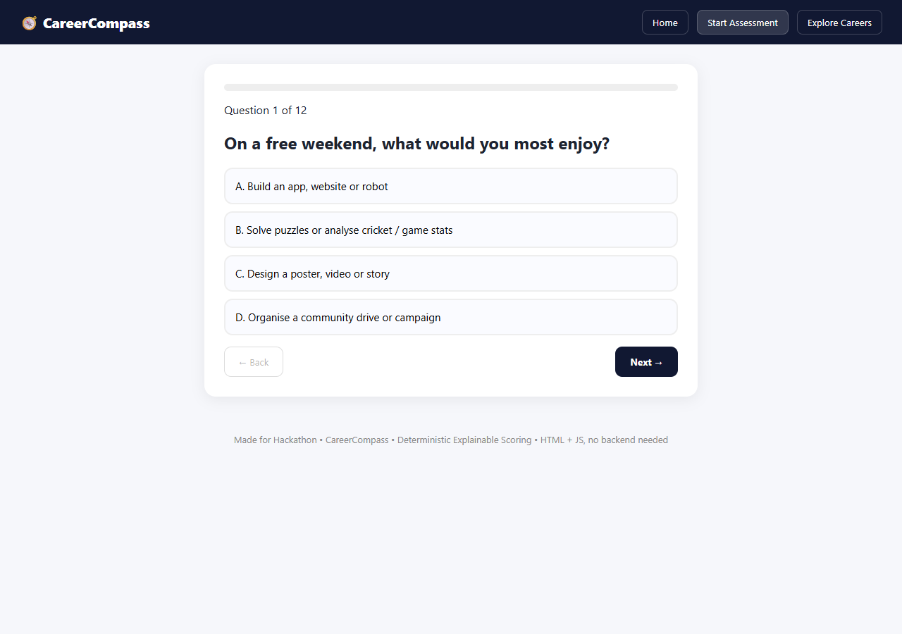
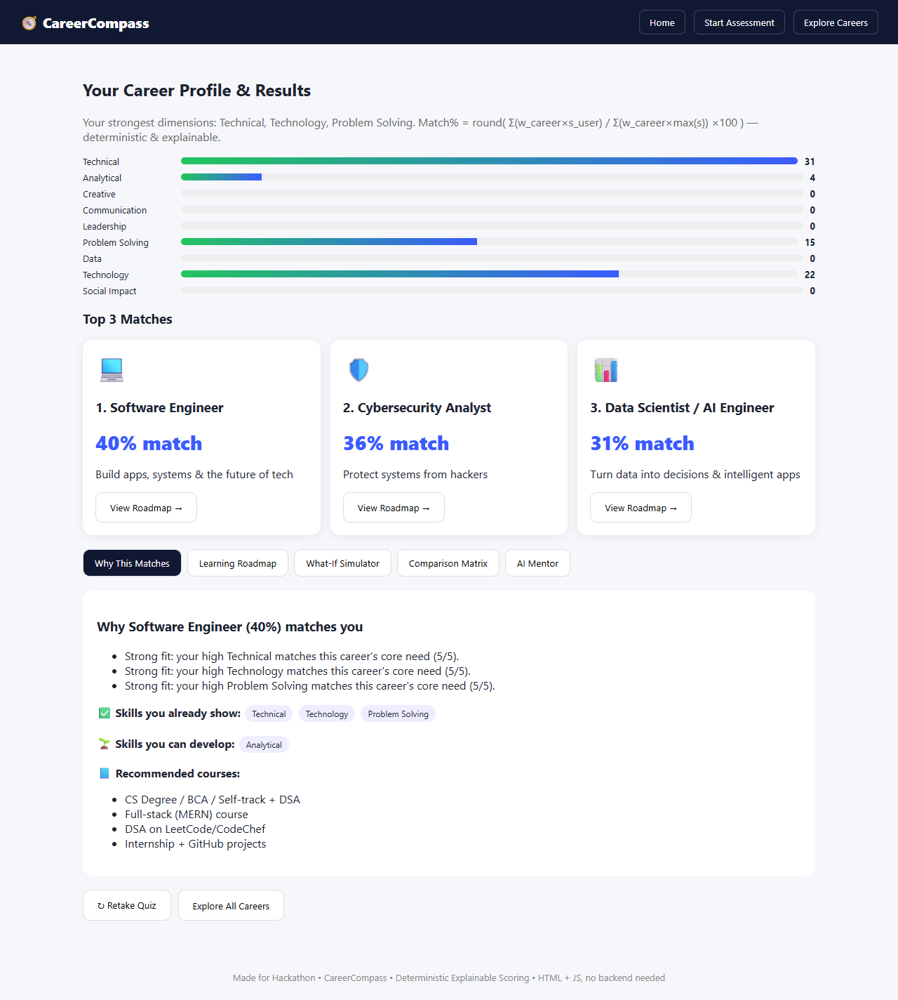
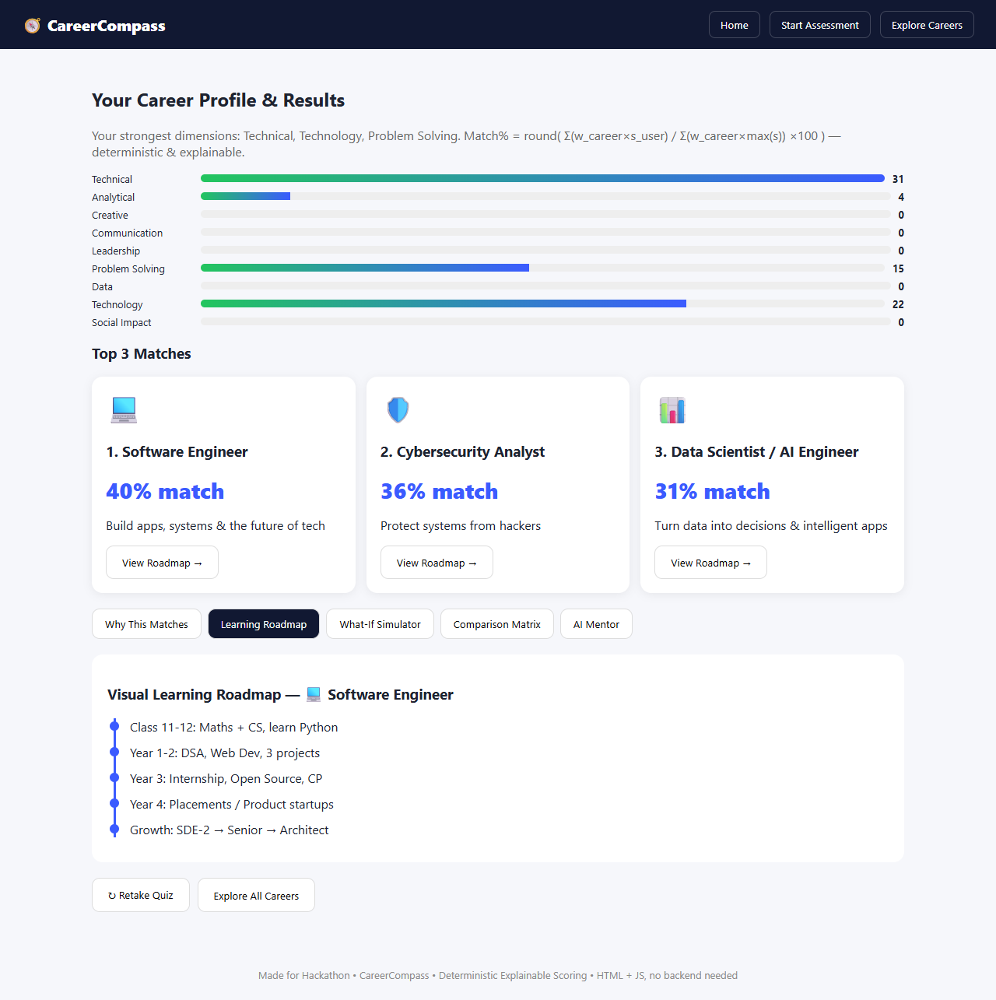
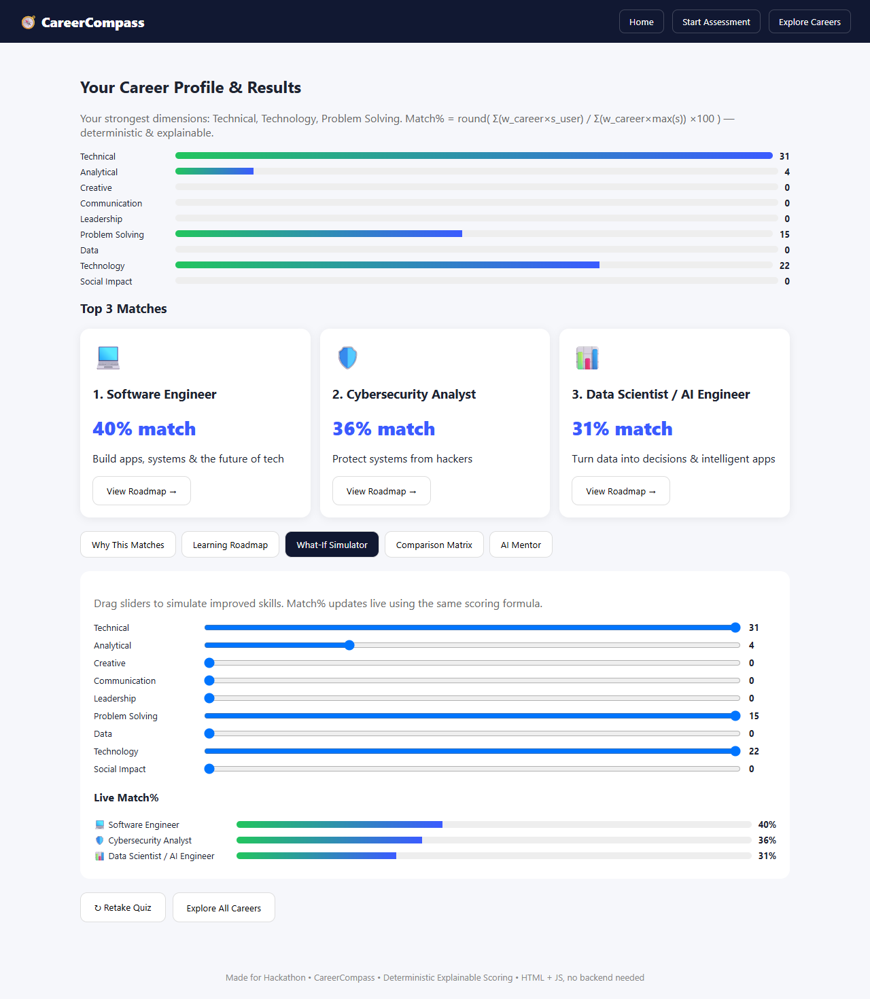
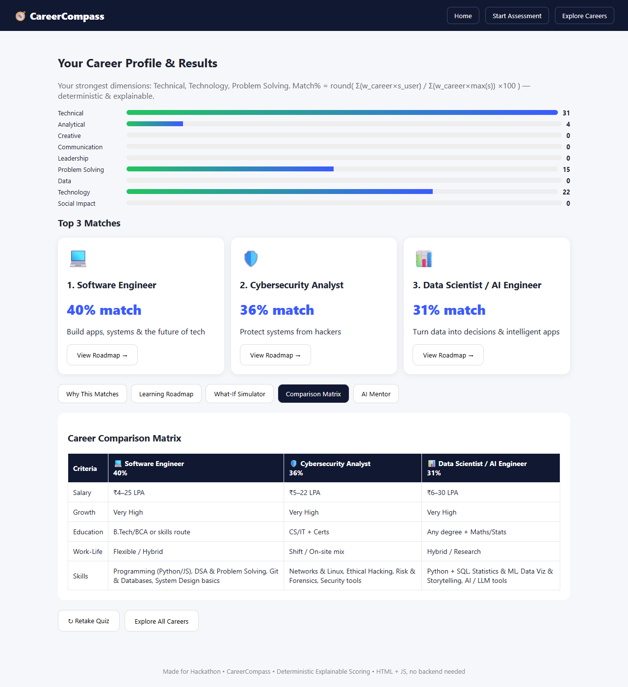
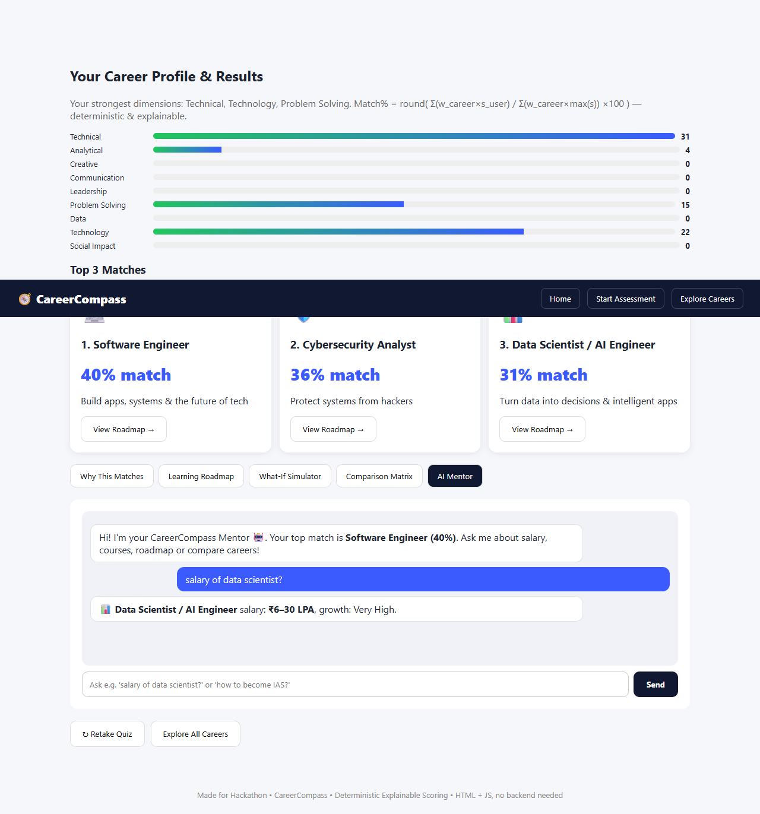

# CareerCompass - One-Stop Career & Education Advisor 🧭

**Team:** Coding Wizards  
**Problem Statement:** #4 - Smart Education

CareerCompass is a quiz-based career guidance platform that helps students explore career paths based on their interests and skills. The results are recommendations based on the quiz responses, not fixed career decisions.

## The Idea

Choosing a career can be confusing, especially when students have many options but do not know where to start. CareerCompass tries to make this process simpler.

The user answers 12 short questions. Each answer contributes to different skill areas such as technical ability, analytical thinking, creativity, communication, leadership, problem solving, data, technology and social impact.

The system then calculates a match percentage for 10 career options and explains the result instead of only showing a career name.

## What CareerCompass Does

- **Career Matching** - Shows career options based on the user's answers.
- **Skill Breakdown** - Explains which skills contributed to the result.
- **Career Roadmap** - Provides a step-by-step path for the selected career.
- **What-If Simulator** - Lets users change skill levels and see how the career matches change.
- **Career Comparison** - Compares careers using information such as salary, growth and education requirements.
- **AI Mentor Chat (Offline)** - A simple rule-based chat feature that answers common career-related questions using the career data built into the project. It does not require an API key or internet connection.

## How to Run

There is no npm, Python or other setup required. The project uses plain HTML, CSS and JavaScript, so it can be opened directly in a browser.

### Option 1 - Open directly

1. Download or clone this repository.
2. Open the project folder.
3. Double-click `index.html`.
4. Start the assessment.

### Option 2 - Using VS Code

Open the project in VS Code and use **Live Server** to run `index.html`.

## Project Structure

```text
index.html                  -> Main page
css/style.css               -> Styling and layout
js/data.js                  -> Quiz questions and career data
js/scoringEngine.js         -> Career matching and scoring formula
js/app.js                   -> Quiz, tabs, simulator and mentor logic
screenshots/                -> Project screenshots
```

## How the Scoring Works

The career match is calculated using the same formula throughout the quiz and the What-If Simulator:

```text
Match% = round( sum(w_career * s_user) / sum(w_career * max(s)) * 100 )
```

Where:

- `w_career` = how important a particular skill is for a career (1 to 5)
- `s_user` = the user's score for that skill
- `max(s)` = the maximum possible score for that skill

The same answers produce the same results because the scoring system does not use random values.

## Screenshots

### 1. Landing Page



### 2. Quiz Page



### 3. Results - Top Matches



### 4. Roadmap and Simulator





### 5. Comparison and Mentor





## Quick Demo Flow

If you want to try the main features quickly:

1. Start the quiz and select all **A** options to see Software Engineer / Cyber Security near the top.
2. Retake the quiz and select all **D** options to see IAS / Teacher near the top.
3. Open the **What-If Simulator** and increase the Creative skill to see the match percentages update live.
4. Try the **Mentor** with questions such as `how to become IAS?` or `courses for data scientist?`

## Tech Stack

| Technology | Used For |
|---|---|
| HTML5 | Page structure |
| CSS3 | Styling and responsive layout |
| JavaScript | Quiz logic, scoring, simulator and mentor |
| Git & GitHub | Version control and project submission |

## Why We Kept It Simple

We considered React, but decided to keep the project in plain HTML, CSS and JavaScript. This makes it easy to run during a demo without installing packages or depending on an internet connection.

There is no backend. The quiz, career data, scoring and mentor features run in the browser.

The mentor is currently rule-based rather than a generative AI system. It uses keywords and the career data already included in the project, which keeps it usable offline.

## Current Limitations and Future Improvements

The current version has 10 career options. Some improvements we would like to make are:

- Add more career options and more detailed career information.
- Improve the mentor with a proper AI/API integration.
- Add a Hindi language option.
- Allow users to save or download their results as a PDF.

## Team

Built by **Coding Wizards**.

The project was developed as a hackathon submission with work across development, career data collection, testing and refinement.

## Thank You

Thanks for checking out CareerCompass! ⭐
